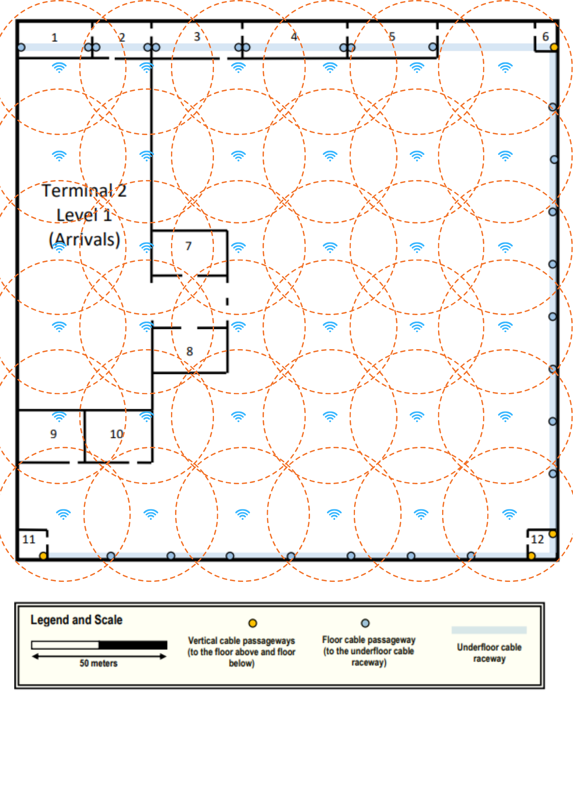

# Terminal 2 – Level 1

## Descrição do Piso

O Level 1 do Terminal 2 corresponde à zona de Arrivals do terminal.

Este piso possui uma infraestrutura preparada para suportar a instalação de cablagem de rede. Ao longo do piso existe um underfloor cable raceway, que permite a 
passagem de cabos por baixo do chão e facilita a distribuição da cablagem entre as diferentes salas do terminal.

Este sistema encontra-se também ligado a uma external technical ditch, o que permite a ligação da infraestrutura de rede do edifício a outras infraestruturas externas.

Na planta estão identificados vários pontos de acesso ao raceway, que permitem encaminhar os cabos provenientes das diferentes salas até ao sistema principal de cablagem.

Existem ainda quatro vertical cable passageways que percorrem os vários pisos do edifício e que permitem a ligação da infraestrutura de rede entre diferentes níveis do 
terminal.

O piso possui também um dropped ceiling localizado a aproximadamente 4 metros do chão, criando um espaço técnico adequado para a instalação de cabos de rede e 
equipamentos como wireless access points.

---

## Regras Especiais do Piso

De acordo com o enunciado do projeto, algumas salas do Level 1 possuem requisitos específicos relativamente à instalação de network outlets.

As salas destinadas a áreas de trabalho devem possuir o número padrão de network outlets, calculado com base na densidade de cablagem definida para o projeto.

Por outro lado, algumas salas correspondem a zonas de circulação, instalações técnicas ou áreas de apoio, pelo que não necessitam de network outlets.

Além disso, algumas destas salas podem ser utilizadas para alojar infraestrutura de rede, como equipamentos de cross-connect, permitindo a instalação de armários de 
telecomunicações e outros equipamentos necessários ao funcionamento da rede do piso.

---

### Salas com Network Outlets
1, 2, 3, 4, 5, 7, 8

### Salas sem Network Outlets
6, 9, 10, 11, 12

### Salas possíveis para Infraestrutura
6, 11, 12

---

## Mediçōes das Salas

| Room | Length (m) | Width (m) | Area (m²) | Number of Outlets |
|------|-----------:|----------:|----------:|------------------:|
| 1    |      27.12 |     12.71 |    344.70 |                69 |
| 2    |      21.19 |     12.71 |    269.32 |                54 |
| 3    |      33.90 |     12.71 |    430.87 |                87 |
| 4    |      38.98 |     12.71 |    495.44 |               100 |
| 5    |      33.90 |     12.71 |    430.87 |                87 |
| 7    |      27.96 |     15.57 |    435.33 |                88 |
| 8    |      27.96 |     15.57 |    435.33 |                88 |

---

## Localização do Horizontal Cross-Connect (HC)

O HC do Level 1 foi colocado na Room 12.

Esta sala foi escolhida por se encontrar próxima de duas vertical cable passageways, facilitando a ligação ao backbone 
do edifício e a interligação entre pisos.

Além disso, a Room 12 localiza-se junto à parede exterior direita e à parede inferior do piso, onde o enunciado exige a 
instalação de network outlets adicionais a cada cinco metros, permitindo reduzir o comprimento médio da cablagem 
necessária para esses pontos.

---

## Deployment de Network Outlets 

A distribuição dos network outlets foi definida de forma a garantir acessibilidade adequada a pontos de rede em todo o 
piso.

Nas salas que requerem outlets, estes foram distribuídos ao longo das paredes e dimensionados segundo a densidade padrão 
de cablagem estruturada de **2 network outlets por cada 10 m²** de área.

Foram também instalados outlets adicionais ao longo da parede exterior direita e da parede inferior do piso, com uma 
densidade de **um outlet a cada cinco metros**.

---

## Deployment of Hardware

### Structured Cabling Layout – Level 1

The following diagram shows the placement of the HC, network outlets,
cable pathways and wireless access points across the floor.

### Cable Pathways

Cables from each room are routed to the nearest **floor cable passageway**.
From there, they follow the **underfloor cable raceway** to the
Horizontal Cross-Connect located in **Room 12**.

Wireless access points are installed above the **dropped ceiling**
and connected to the HC through the nearest pathway.

### Cable Length Estimation

| Room | HC → Passageway | Outlets → Passageway | Total |
|------|-----------------|----------------------|-------|
|      |                 |                      |       |
|      |                 |                      |       |
|      |                 |                      |       |

### Total Cabling – Level 1

CAT7:

Monomode Fibre:

### Wireless Access Points – Level 1

Access points were distributed across the ceiling to ensure
full wireless coverage of the terminal floor.

---

## Inventário de Hardware 

| Network Outlets | Cabo CAT7 | Monomode 10 | Patch Panels (48) | Patch Panels (24) | Switch | Access Points | IC | HC |
|-----------------|-----------|-------------|-------------------|-------------------|--------|---------------|----|----|
|                 |           |             |                   |                   |        |               |    |    |

---

## Sala de Infraestrutura

*(sala escolhida para HC / rack)*

| Patch Panel | Size (U) | Switch (U) | Final Size (U) |
|-------------|----------|------------|----------------|
|             |          |            |                |

---

## Dimensionamento do Rack

*(cálculo do tamanho necessário do telecom enclosure)*

# Conclusão

*(síntese do projeto desenvolvido)*

