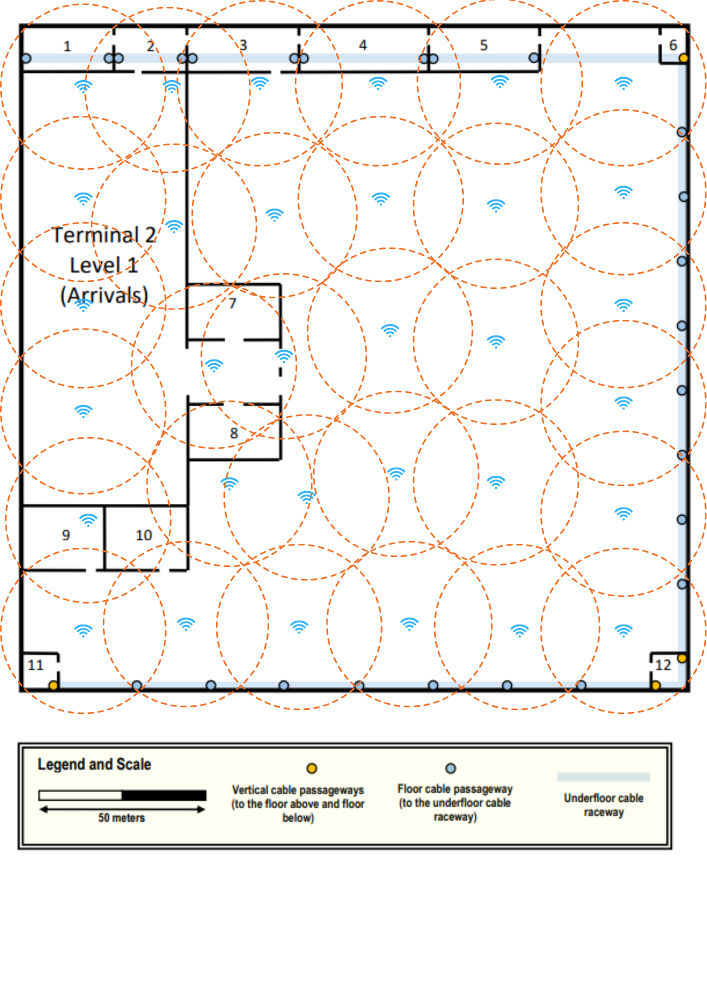
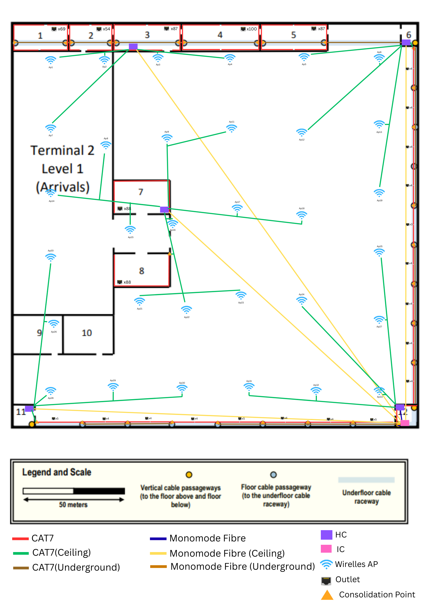

# Terminal 2 – Level 1

## Descrição do Piso

O **Level 1 do Terminal 2** corresponde à zona de **Arrivals**.

Este piso possui:

- **Underfloor cable raceway** para encaminhamento de cabos
- **Floor cable passageways** que ligam as salas ao raceway
- **4 vertical cable passageways** para ligação entre pisos
- **Dropped ceiling a 4 metros**, utilizado para instalação de cabos e access points

A infraestrutura também está ligada à **external technical ditch**, permitindo ligação à rede externa do aeroporto.

---

## Network Outlets

### Regras de Instalação

- Densidade padrão: **2 network outlets por cada 10 m²**
- Nas paredes exteriores **direita e inferior** existe **1 outlet a cada 5 metros**

### Salas com Network Outlets

1, 2, 3, 4, 5, 7, 8

### Salas sem Network Outlets

6, 9, 10, 11, 12

### Salas possíveis para Infraestrutura

6, 11, 12

---

## Mediçōes das Salas 

| Room | Length (m) | Width (m) | Area (m²) | Number of Outlets |
|------|-----------:|----------:|----------:|------------------:|
| 1    |      27.12 |     12.71 |    344.70 |                69 |
| 2    |      21.19 |     12.71 |    269.32 |                54 |
| 3    |      33.90 |     12.71 |    430.87 |                87 |
| 4    |      38.98 |     12.71 |    495.44 |               100 |
| 5    |      33.90 |     12.71 |    430.87 |                87 |
| 7    |      27.96 |     15.57 |    435.33 |                88 |
| 8    |      27.96 |     15.57 |    435.33 |                88 |

---

## Cross-Connect Infrastructure

### Horizontal Cross-Connects (HC)

Foram instalados **5 HCs** no piso:

- HC1 – Room 3
- HC2 – Room 6
- HC3 – Room 7
- HC4 – Room 11
- HC5 – Room 12

### Intermediate Cross-Connect (IC)

O **IC encontra-se na Room 12**, permitindo ligação ao backbone do edifício através das **vertical cable passageways**.

---

## Wireless Network

### Wireless Coverage

A cobertura wireless foi garantida através da instalação de **32 wireless access points** no espaço acima do **dropped ceiling**.

---

## Cabling Infrastructure

### Structured Cabling Layout

---

---

## Cable Length Calculations

### IC (in room 12) → HCs ###

|          To HC          | Length of Fibre (m) |                     
|:-----------------------:|:-------------------:|
| HC1 - Room 3 (ceiling)  |       225.57        |
| HC2 - Room 6 (ceiling)  |       185.33        |       
| HC3 - Room 7 (ceiling)  |       154.84        | 
| HC4 - Room 11 (ceiling) |       182.05        |     
|      HC5 - Room 12      |        4.90         |
|         *Total*         |     **752.69**      |

### HC1 (in room 3) ###
|          To Room or Ap           | Length of CAT7 (m) |                     
|:--------------------------------:|:------------------:|
| 1 - left floor cable passageway  |       58.96        |
| 1 - right floor cable passageway |       35.04        |       
| 2 - left floor cable passageway  |       33.09        |     
| 2 - right floor cable passageway |       12.77        |   
| 3 - left floor cable passageway  |        0.5         |
| 4 - left floor cable passageway  |       44.77        |
|          Access Point 1          |       34.08        |
|          Access Point 2          |       11.89        |
|          Access Point 3          |       10.88        |
|          Access Point 4          |       43.23        |
|          Access Point 7          |       51.33        |
|             *Total*              |     **336.54**     |

### HC2 (in room 6) ###
|          To Room or Ap           | Length of CAT7 (m) |                     
|:--------------------------------:|:------------------:|
| 4 - left floor cable passageway  |       71.27        |
| 5 - right floor cable passageway |       68.68        |       
| 5 - left floor cable passageway  |       37.87        |     
|    1º floor cable passageway     |       22.41        |   
|    2º floor cable passageway     |       42.41        | 
|    3º floor cable passageway     |       61.67        |
|    4º floor cable passageway     |       81.27        |
|          Access Point 5          |       44.46        |
|          Access Point 6          |       15.20        |
|         Access Point 12          |       64.37        |
|         Access Point 13          |       41.38        |
|         Access Point 19          |       71.29        |
|             *Total*              |     **622.28**     |

### HC3 (in room 7) ###
|  To Room or Ap  | Length of CAT7 (m) |                     
|:---------------:|:------------------:|
|        7        |        0.50        |
|   8 - ceiling   |       21.42        |
| Access Point 8  |       41.86        |
| Access Point 9  |       34.01        |
| Access Point 11 |       50.00        |
| Access Point 14 |       50.96        |
| Access Point 15 |       17.35        |
| Access Point 16 |        4.58        |
| Access Point 17 |       34.57        |
| Access Point 18 |       66.98        |
| Access Point 21 |       42.71        |
| Access Point 22 |       45.27        |
| Access Point 23 |       53.49        |
|     *Total*     |     **463.7**      |

### HC4 (in room 11) ###
|       To Room or Ap       | Length of CAT7 (m) |                     
|:-------------------------:|:------------------:|
| 1º floor cable passageway |       28.76        |   
| 2º floor cable passageway |       51.13        | 
| 3º floor cable passageway |       76.61        |
|      Access Point 20      |       71.27        |
|      Access Point 26      |       42.84        |
|      Access Point 28      |        7.09        |
|      Access Point 29      |       40.33        |
|      Access Point 30      |       71.29        | 
|          *Total*          |     **389.32**     |

### HC5 (in room 12) ###
|       To Room or Ap       | Length of CAT7 (m) |                     
|:-------------------------:|:------------------:|
| 1º floor cable passageway |       21.70        |   
| 2º floor cable passageway |       43.92        | 
| 3º floor cable passageway |       66.51        |
| 4º floor cable passageway |       87.41        |
|      Access Point 24      |       67.66        |
|      Access Point 25      |       72.79        |
|      Access Point 27      |       42.44        |
|      Access Point 31      |       72.55        |
|      Access Point 32      |       38.90        | 
|      Access Point 33      |        6.55        |
|          *Total*          |     **520.43**     |

### Outlet cables for Room 1 - left floor cable passageway (34 outlets) ###
1,17 + 2,34 + 3,50 + 4,67 + 5,84 + 7,01 + 8,18 + 9,34 + 10,51 + 11,68 + 12,85 + 14,02 + 15,18 + 16,35 + 17,52 + 18,69 + 19,86 + 1,17 + 2,34 + 3,50 + 4,67 + 5,84 + 7,01 + 8,18 + 9,34 + 10,51 + 11,68 + 12,85 + 14,02 + 15,18 + 16,35 + 17,52 + 18,69 + 19,86 = 357,39 m

### Outlet cables for Room 1 - right floor cable passageway(35 outlets) ###
1,13 + 2,27 + 3,40 + 4,54 + 5,67 + 6,81 + 7,94 + 9,08 + 10,21 + 11,35 + 12,48 + 13,61 + 14,75 + 15,88 + 17,02 + 18,15 + 19,29 + 1,13 + 2,27 + 3,40 + 4,54 + 5,67 + 6,81 + 7,94 + 9,08 + 10,21 + 11,35 + 12,48 + 13,61 + 14,75 + 15,88 + 17,02 + 18,15 + 19,29 + 20,42 = 367,60 m

---

### Outlet cables for Room 2 - left floor cable passageway(27 outlets) ###
1,25 + 2,50 + 3,75 + 4,99 + 6,24 + 7,49 + 8,74 + 9,99 + 11,24 + 12,49 + 13,73 + 14,98 + 16,23 + 1,25 + 2,50 + 3,75 + 4,99 + 6,24 + 7,49 + 8,74 + 9,99 + 11,24 + 12,49 + 13,73 + 14,98 + 16,23 + 17,48 = 244,71 m

### Outlet cables for Room 2 - right floor cable passageway(27 outlets) ###
1,25 + 2,50 + 3,75 + 4,99 + 6,24 + 7,49 + 8,74 + 9,99 + 11,24 + 12,49 + 13,73 + 14,98 + 16,23 + 1,25 + 2,50 + 3,75 + 4,99 + 6,24 + 7,49 + 8,74 + 9,99 + 11,24 + 12,49 + 13,73 + 14,98 + 16,23 + 17,48 = 244,71 m

---

### Outlet cables for Room 3 - left floor cable passageway (43 outlets) ###
1,08 + 2,16 + 3,24 + 4,32 + 5,40 + 6,48 + 7,56 + 8,63 + 9,71 + 10,79 + 11,87 + 12,95 + 14,03 + 15,11 + 16,19 + 17,27 + 18,35 + 19,43 + 20,51 + 21,59 + 22,67 + 1,08 + 2,16 + 3,24 + 4,32 + 5,40 + 6,48 + 7,56 + 8,63 + 9,71 + 10,79 + 11,87 + 12,95 + 14,03 + 15,11 + 16,19 + 17,27 + 18,35 + 19,43 + 20,51 + 21,59 + 22,67 + 23,74 = 522,38 m

### Outlet cables for Room 3 - right floor cable passageway (44 outlets) ###
1,05 + 2,11 + 3,16 + 4,22 + 5,27 + 6,33 + 7,38 + 8,44 + 9,49 + 10,55 + 11,60 + 12,66 + 13,71 + 14,77 + 15,82 + 16,88 + 17,93 + 18,99 + 20,04 + 21,10 + 22,15 + 23,21 + 1,05 + 2,11 + 3,16 + 4,22 + 5,27 + 6,33 + 7,38 + 8,44 + 9,49 + 10,55 + 11,60 + 12,66 + 13,71 + 14,77 + 15,82 + 16,88 + 17,93 + 18,99 + 20,04 + 21,10 + 22,15 + 23,21 = 533,72 m
 
---

### Outlet cables for Room 4 - left floor cable passageway (50 outlets) ###
1,01 + 2,03 + 3,04 + 4,06 + 5,07 + 6,09 + 7,10 + 8,11 + 9,13 + 10,14 + 11,16 + 12,17 + 13,18 + 14,20 + 15,21 + 16,23 + 17,24 + 18,26 + 19,27 + 20,28 + 21,30 + 22,31 + 23,33 + 24,34 + 25,36 + 1,01 + 2,03 + 3,04 + 4,06 + 5,07 + 6,09 + 7,10 + 8,11 + 9,13 + 10,14 + 11,16 + 12,17 + 13,18 + 14,20 + 15,21 + 16,23 + 17,24 + 18,26 + 19,27 + 20,28 + 21,30 + 22,31 + 23,33 + 24,34 + 25,36 = 659,23 m

### Outlet cables for Room 4 - right floor cable passageway (50 outlets) ###
1,01 + 2,03 + 3,04 + 4,06 + 5,07 + 6,09 + 7,10 + 8,11 + 9,13 + 10,14 + 11,16 + 12,17 + 13,18 + 14,20 + 15,21 + 16,23 + 17,24 + 18,26 + 19,27 + 20,28 + 21,30 + 22,31 + 23,33 + 24,34 + 25,36 + 1,01 + 2,03 + 3,04 + 4,06 + 5,07 + 6,09 + 7,10 + 8,11 + 9,13 + 10,14 + 11,16 + 12,17 + 13,18 + 14,20 + 15,21 + 16,23 + 17,24 + 18,26 + 19,27 + 20,28 + 21,30 + 22,31 + 23,33 + 24,34 + 25,36 = 659,23 m

---

### Outlet cables for Room 5 - left floor cable passageway (43 outlets) ###
1,08 + 2,16 + 3,24 + 4,32 + 5,40 + 6,48 + 7,56 + 8,63 + 9,71 + 10,79 + 11,87 + 12,95 + 14,03 + 15,11 + 16,19 + 17,27 + 18,35 + 19,43 + 20,51 + 21,59 + 22,67 + 1,08 + 2,16 + 3,24 + 4,32 + 5,40 + 6,48 + 7,56 + 8,63 + 9,71 + 10,79 + 11,87 + 12,95 + 14,03 + 15,11 + 16,19 + 17,27 + 18,35 + 19,43 + 20,51 + 21,59 + 22,67 + 23,74 = 522,38 m

### Outlet cables for Room 5 - right floor cable passageway (44 outlets) ###
1,05 + 2,11 + 3,16 + 4,22 + 5,27 + 6,33 + 7,38 + 8,44 + 9,49 + 10,55 + 11,60 + 12,66 + 13,71 + 14,77 + 15,82 + 16,88 + 17,93 + 18,99 + 20,04 + 21,10 + 22,15 + 23,21 + 1,05 + 2,11 + 3,16 + 4,22 + 5,27 + 6,33 + 7,38 + 8,44 + 9,49 + 10,55 + 11,60 + 12,66 + 13,71 + 14,77 + 15,82 + 16,88 + 17,93 + 18,99 + 20,04 + 21,10 + 22,15 + 23,21 = 533,72 m

---

### Outlet cables for Room 7 (88 outlets) ###
0,67 + 1,34 + 2,01 + 2,69 + 3,36 + 4,03 + 4,70 + 5,37 + 6,04 + 6,72 + 7,39 + 8,06 + 8,73 + 9,40 + 10,07 + 10,75 + 11,42 + 12,09 + 12,76 + 13,43 + 14,10 + 14,78 + 15,45 + 16,12 + 16,79 + 17,46 + 18,13 + 18,80 + 19,48 + 20,15 + 20,82 + 21,49 + 22,16 + 22,83 + 23,51 + 24,18 + 24,85 + 25,52 + 26,19 + 26,86 + 27,54 + 28,21 + 28,88 + 29,55 + 0,67 + 1,34 + 2,01 + 2,69 + 3,36 + 4,03 + 4,70 + 5,37 + 6,04 + 6,72 + 7,39 + 8,06 + 8,73 + 9,40 + 10,07 + 10,75 + 11,42 + 12,09 + 12,76 + 13,43 + 14,10 + 14,78 + 15,45 + 16,12 + 16,79 + 17,46 + 18,13 + 18,80 + 19,48 + 20,15 + 20,82 + 21,49 + 22,16 + 22,83 + 23,51 + 24,18 + 24,85 + 25,52 + 26,19 + 26,86 + 27,54 + 28,21 + 28,88 + 29,55 = 1329,75 m

---

### Outlet cables for Room 8 (88 outlets) ###
0,67 + 1,34 + 2,01 + 2,69 + 3,36 + 4,03 + 4,70 + 5,37 + 6,04 + 6,72 + 7,39 + 8,06 + 8,73 + 9,40 + 10,07 + 10,75 + 11,42 + 12,09 + 12,76 + 13,43 + 14,10 + 14,78 + 15,45 + 16,12 + 16,79 + 17,46 + 18,13 + 18,80 + 19,48 + 20,15 + 20,82 + 21,49 + 22,16 + 22,83 + 23,51 + 24,18 + 24,85 + 25,52 + 26,19 + 26,86 + 27,54 + 28,21 + 28,88 + 29,55 + 0,67 + 1,34 + 2,01 + 2,69 + 3,36 + 4,03 + 4,70 + 5,37 + 6,04 + 6,72 + 7,39 + 8,06 + 8,73 + 9,40 + 10,07 + 10,75 + 11,42 + 12,09 + 12,76 + 13,43 + 14,10 + 14,78 + 15,45 + 16,12 + 16,79 + 17,46 + 18,13 + 18,80 + 19,48 + 20,15 + 20,82 + 21,49 + 22,16 + 22,83 + 23,51 + 24,18 + 24,85 + 25,52 + 26,19 + 26,86 + 27,54 + 28,21 + 28,88 + 29,55 = 1329,75 m

---

---
### Outlet cables for right side wall ###

| Floor cable passageway | Outlets |                 Length of CAT7 (m)                  |
|:----------------------:|:-------:|:---------------------------------------------------:|
|           1º           |    6    | 4,44 + 8,88 + 13,33 + 4,44 + 8,88 + 13,33 = 53,30 m |   
|           2º           |    4    |         4,40 + 8,80 + 4,40 + 8,80 = 26,40 m         |
|           3º           |    4    |         4,40 + 8,80 + 4,40 + 8,80 = 26,40 m         |
|           4º           |    3    |            5,87 + 5,87 + 11,73 = 23,47 m            |
|           5º           |    4    |         4,40 + 8,80 + 4,40 + 8,80 = 26,40 m         |   
|           6º           |    4    |         4,40 + 8,80 + 4,40 + 8,80 = 26,40 m         |
|           7º           |    4    |         4,40 + 8,80 + 4,40 + 8,80 = 26,40 m         |
|           8º           |    6    | 4,44 + 8,88 + 13,33 + 4,44 + 8,88 + 13,33 = 53,30 m |
|        *Total*         | **35**  |                     **235.67**                      |

---

### Outlet cables for bottom side wall ###

| Floor cable passageway | Outlets |                     Length of CAT7 (m)                      |
|:----------------------:|:-------:|:-----------------------------------------------------------:|
|           1º           |    7    | 4,73 + 9,46 + 14,19 + 4,73 + 9,46 + 14,19 + 18,93 = 75,70 m |   
|           2º           |    4    |            5,25 + 10,50 + 5,25 + 10,50 = 31,50 m            |
|           3º           |    4    |            5,25 + 10,50 + 5,25 + 10,50 = 31,50 m            |
|           4º           |    5    |         4,20 + 8,40 + 4,20 + 8,40 + 12,60 = 37,80 m         |
|           5º           |    4    |            5,25 + 10,50 + 5,25 + 10,50 = 31,50 m            |   
|           6º           |    4    |            5,25 + 10,50 + 5,25 + 10,50 = 31,50 m            |
|           7º           |    7    | 4,73 + 9,46 + 14,19 + 4,73 + 9,46 + 14,19 + 18,93 = 75,70 m |
|        *Total*         | **35**  |                          **315,2**                          |

---

## Hardware Inventory

| Network Outlets | CAT7 Cables Length | Monomode 10 Cables Length | Patch Panels (cobre) | Patch Panels (fibra) | Access Point | IC | HC | CP|
|:---------------:|:------------------:|:-------------------------:|:--------------------:|:--------------------:|:------------:|:--:|:--:|:--:|
|       643       |      10187.21      |           752.69          |          5           |          6           |      31      | 1  | 5  | 26 |