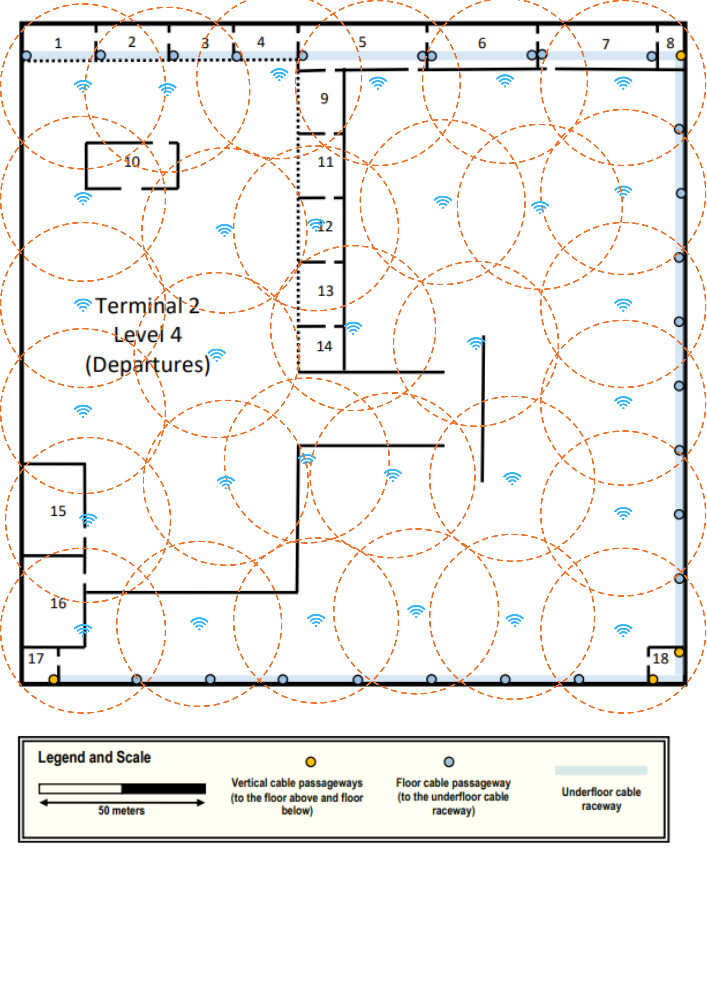
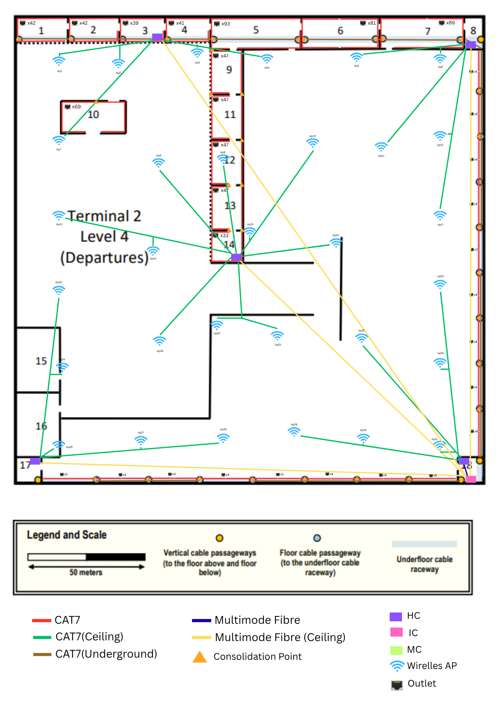

# Terminal 2 – Level 4

## Descrição do Piso

O **Level 4 do Terminal 2** corresponde à zona de **Departures**.

Este piso possui:

- **Underfloor cable raceway** para encaminhamento de cabos
- **4 vertical cable passageways** para ligação entre pisos
- Ligação à infraestrutura externa através de um nível inferior, a aproximadamente **25 metros**
- **Dropped ceiling a 4 metros**, utilizado para instalação de cabos e access points

Esta infraestrutura permite suportar a instalação do sistema de **structured cabling** e da rede wireless do piso.

---

## Network Outlets

### Regras de Instalação

- Densidade padrão: **2 network outlets por cada 10 m²**
- Nas paredes exteriores **direita e inferior** existe **1 outlet a cada 5 metros**

### Salas com Network Outlets

1, 2, 3, 4, 5, 6, 7, 9, 10, 11, 12, 13, 14

### Salas sem Network Outlets

8, 15, 16, 17, 18

### Salas possíveis para Infraestrutura

8, 17, 18

---

## Mediçōes das Salas

| Room | Length (m) | Width (m) | Area (m²) |   Number of Outlets |
|------|-----------:|----------:|----------:|--------------------:|
| 1    |      21.31 |      9.84 |    209.69 |                  42 |
| 2    |      21.31 |      9.84 |    209.69 |                  42 |
| 3    |      19.67 |      9.84 |    193.55 |                  39 |
| 4    |      20.49 |      9.84 |    201.62 |                  41 |
| 5    |      37.70 |     12.30 |    463.71 |                  93 |
| 6    |      32.79 |     12.30 |    403.32 |                  81 |
| 7    |      36.07 |     12.30 |    443.66 |                  89 |
| 9    |      18.03 |     13.11 |    343.88 |                  47 |
| 10   |      26.23 |     13.11 |    234.37 |                  69 |
| 11   |      18.03 |     13.11 |    234.37 |                  47 |
| 12   |      18.03 |     13.11 |    234.37 |                  47 |
| 13   |      18.03 |     13.11 |    234.37 |                  47 |
| 14   |      12.30 |     13.11 |    161.25 |                  33 |

---

## Cross-Connect Infrastructure

### Horizontal Cross-Connects (HC)

*(Inserir aqui a distribuição dos HCs pelo piso, no mesmo formato do Level 1)*

- HC1 – Room 3
- HC2 – Room 8
- HC3 – Room 14
- HC4 – Room 17
- HC5 – Room 18

### Intermediate Cross-Connect (IC)

O **IC encontra-se na Room 18**, permitindo ligação ao backbone do edifício através das **vertical cable passageways**.

---

## Wireless Network

### Wireless Coverage

A cobertura wireless foi garantida através da instalação de **access points** no espaço acima do **dropped ceiling**.

---

## Cabling Infrastructure

### Structured Cabling Layout

---

## Cable Length Calculations

### IC / HC → HCs ###

|          To HC          | Length of Fibre (m) |                     
|:-----------------------:|:-------------------:|
| HC1 - Room 3 (ceiling)  |       224.22        |
| HC2 - Room 8 (ceiling)  |       179.75        |       
| HC3 - Room 14 (ceiling) |       131.23        | 
| HC4 - Room 17 (ceiling) |       179.30        |     
|      HC5 - Room 18      |        4.12         |
|         *Total*         |     **539,39**      |

---

### HC1 (in room 3) ###

|             To Room or Ap             | Length of CAT7 (m) |
|:-------------------------------------:|:------------------:|
|            1 - underground            |       55.46        |
|            2 - underground            |       33.81        |
|                   3                   |        0.5         |
|            4 - underground            |        2.92        |
|            5 - underground            |       21.76        |
|             10 - ceiling              |       34.30        |
| 9 (left side) - connection to room 5  |       32.48        |
| 11 (left side) - connection to room 9 |       57.21        |
|            Access Point 1             |       39.65        |
|            Access Point 2             |       15.47        |
|            Access Point 3             |       15.11        |
|            Access Point 4             |       41.93        |
|            Access Point 7             |       54.18        |
|                *Total*                |     **404.78**     |

---

### HC2 (in room 8) ###

|          To Room or Ap           | Length of CAT7 (m) |                     
|:--------------------------------:|:------------------:|
| 6 - left floor cable passageway  |       67.78        |
| 6 - right floor cable passageway |       38.33        |
| 7 - right floor cable passageway |       34.41        |       
| 7 - left floor cable passageway  |        2.33        |     
|    1º floor cable passageway     |       19.72        |   
|    2º floor cable passageway     |       38.77        | 
|    3º floor cable passageway     |       58.37        |
|    4º floor cable passageway     |       76.41        |
|          Access Point 5          |       43.81        |
|          Access Point 6          |       11.92        |
|         Access Point 11          |       51.61        |
|         Access Point 12          |       36.41        |
|         Access Point 17          |       67.80        |
|             *Total*              |     **547.67**     |

---

### HC3 (in room 14) ###

|              To Room or Ap              | Length of CAT7 (m) |
|:---------------------------------------:|:------------------:|
| 9 (right side) - connection to room 11  |       68.81        |
| 11 (right side) - connection to room 12 |       49.21        |
| 12 (right side) - connection to room 13 |       30.32        |
| 13 (right side) - connection to room 14 |       11.71        |
| 12 (left side) - connection to room 13  |       59.56        |
| 13 (left side) - connection to room 14  |       19.02        |
|                   14                    |        0.50        |
|             Access Point 8              |       46.72        |
|             Access Point 9              |       37.23        |
|             Access Point 10             |       55.91        |
|             Access Point 13             |       71.43        |
|             Access Point 14             |       33.24        |
|             Access Point 15             |        7.07        |
|             Access Point 16             |       37.41        |
|             Access Point 19             |       43.07        |
|             Access Point 20             |       25.60        |
|             Access Point 21             |       32.18        |
|                 *Total*                 |     **628.99**     |

---

### HC4 (in room 17) ###

|       To Room or Ap       | Length of CAT7 (m) |
|:-------------------------:|:------------------:|
| 1º floor cable passageway |       28.59        |   
| 2º floor cable passageway |       50.47        |
| 3º floor cable passageway |       72.34        |
|      Access Point 18      |       68.06        |
|      Access Point 24      |       36.26        |
|      Access Point 26      |        7.08        |
|      Access Point 27      |       42.23        |
|      Access Point 28      |       75.50        |
|          *Total*          |     **380.53**     |

---

### HC5 (in room 18) ###

|       To Room or Ap       | Length of CAT7 (m) |
|:-------------------------:|:------------------:|
| 1º floor cable passageway |       21.51        |   
| 2º floor cable passageway |       43.24        | 
| 3º floor cable passageway |       65.40        |
| 4º floor cable passageway |       86.81        |
|      Access Point 22      |       62.29        |
|      Access Point 23      |       70.22        |
|      Access Point 25      |       37.76        |
|      Access Point 29      |        67.0        |
|      Access Point 30      |       41.10        | 
|      Access Point 31      |        7.72        |
|          *Total*          |     **503.05**     |

---

### Outlet cables for Room 1 ###

1,25 + 2,50 + 3,75 + 5,00 + 6,25 + 7,49 + 8,74 + 9,99 + 11,24 + 12,49 + 13,74 + 14,99 + 16,24 + 17,49 + 18,74 + 19,98 + 21,23 + 22,48 + 23,73 + 24,98 + 26,23 + 1,25 + 2,50 + 3,75 + 5,00 + 6,25 + 7,49 + 8,74 + 9,99 + 11,24 + 12,49 + 13,74 + 14,99 + 16,24 + 17,49 + 18,74 + 19,98 + 21,23 + 22,48 + 23,73 + 24,98 + 26,23 = 577,06 m

---

### Outlet cables for Room 2 ###

1,25 + 2,50 + 3,75 + 5,00 + 6,25 + 7,49 + 8,74 + 9,99 + 11,24 + 12,49 + 13,74 + 14,99 + 16,24 + 17,49 + 18,74 + 19,98 + 21,23 + 22,48 + 23,73 + 24,98 + 26,23 + 1,25 + 2,50 + 3,75 + 5,00 + 6,25 + 7,49 + 8,74 + 9,99 + 11,24 + 12,49 + 13,74 + 14,99 + 16,24 + 17,49 + 18,74 + 19,98 + 21,23 + 22,48 + 23,73 + 24,98 + 26,23 = 577,06 m

---

### Outlet cables for Room 3:  ###

1,26 + 2,52 + 3,78 + 5,04 + 6,31 + 7,57 + 8,83 + 10,09 + 11,35 + 12,61 + 13,87 + 15,13 + 16,39 + 17,65 + 18,92 + 20,18 + 21,44 + 22,70 + 23,96 + 25,22 + 26,48 + 27,74 + 29,00 + 30,26 + 31,53 + 32,79 + 34,05 + 35,31 + 36,57 + 37,83 + 39,09 + 40,35 + 41,61 + 42,87 + 44,14 + 45,40 + 46,66 + 47,92 + 49,18 = 983,60 m

---

### Outlet cables for Room 4: ###

1,24 + 2,48 + 3,72 + 4,96 + 6,20 + 7,44 + 8,68 + 9,92 + 11,16 + 12,40 + 13,63 + 14,87 + 16,11 + 17,35 + 18,59 + 19,83 + 21,07 + 22,31 + 23,55 + 24,79 + 1,24 + 2,48 + 3,72 + 4,96 + 6,20 + 7,44 + 8,68 + 9,92 + 11,16 + 12,40 + 13,63 + 14,87 + 16,11 + 17,35 + 18,59 + 19,83 + 21,07 + 22,31 + 23,55 + 24,79 + 26,03 = 546,62 m

---

### Outlet cables for Room 5 - left floor cable passageway (50 outlets) ###

1,15 + 2,29 + 3,44 + 4,58 + 5,73 + 6,88 + 8,02 + 9,17 + 10,31 + 11,46 + 12,61 + 13,75 + 14,90 + 16,04 + 17,19 + 18,34 + 19,48 + 20,63 + 21,77 + 22,92 + 24,07 + 25,21 + 26,36 + 27,50 + 28,65 + 1,15 + 2,29 + 3,44 + 4,58 + 5,73 + 6,88 + 8,02 + 9,17 + 10,31 + 11,46 + 12,61 + 13,75 + 14,90 + 16,04 + 17,19 + 18,34 + 19,48 + 20,63 + 21,77 + 22,92 + 24,07 + 25,21 + 26,36 + 27,50 + 28,65 = 744,90 m

### Outlet cables for Room 5 - right floor cable passageway (43 outlets) ###

0,79 + 1,58 + 2,36 + 3,15 + 3,94 + 4,73 + 5,51 + 6,30 + 7,09 + 7,88 + 8,66 + 9,45 + 10,24 + 11,03 + 11,82 + 12,60 + 13,39 + 14,18 + 14,97 + 15,75 + 16,54 + 0,79 + 1,58 + 2,36 + 3,15 + 3,94 + 4,73 + 5,51 + 6,30 + 7,09 + 7,88 + 8,66 + 9,45 + 10,24 + 11,03 + 11,82 + 12,60 + 13,39 + 14,18 + 14,97 + 15,75 + 16,54 + 17,33 = 381,23 m

---

### Outlet cables for Room 6 - left floor cable passageway (40 outlets) ###

1,13 + 2,25 + 3,38 + 4,51 + 5,64 + 6,76 + 7,89 + 9,02 + 10,14 + 11,27 + 12,40 + 13,52 + 14,65 + 15,78 + 16,91 + 18,03 + 19,16 + 20,29 + 21,41 + 22,54 + 1,13 + 2,25 + 3,38 + 4,51 + 5,64 + 6,76 + 7,89 + 9,02 + 10,14 + 11,27 + 12,40 + 13,52 + 14,65 + 15,78 + 16,91 + 18,03 + 19,16 + 20,29 + 21,41 + 22,54 = 473,34 m

### Outlet cables for Room 6 - right floor cable passageway (41 outlets) ###

1,10 + 2,20 + 3,30 + 4,40 + 5,50 + 6,60 + 7,70 + 8,80 + 9,90 + 11,00 + 12,09 + 13,19 + 14,29 + 15,39 + 16,49 + 17,59 + 18,69 + 19,79 + 20,89 + 21,99 + 1,10 + 2,20 + 3,30 + 4,40 + 5,50 + 6,60 + 7,70 + 8,80 + 9,90 + 11,00 + 12,09 + 13,19 + 14,29 + 15,39 + 16,49 + 17,59 + 18,69 + 19,79 + 20,89 + 21,99 + 23,09 = 484,88 m

---

### Outlet cables for Room 7 - left floor cable passageway (44 outlets) ###

0,69 + 1,38 + 2,07 + 2,76 + 3,45 + 4,14 + 4,83 + 5,51 + 6,20 + 6,89 + 7,58 + 8,27 + 8,96 + 9,65 + 10,34 + 11,03 + 11,72 + 12,41 + 13,10 + 13,79 + 14,48 + 15,17 + 0,69 + 1,38 + 2,07 + 2,76 + 3,45 + 4,14 + 4,83 + 5,51 + 6,20 + 6,89 + 7,58 + 8,27 + 8,96 + 9,65 + 10,34 + 11,03 + 11,72 + 12,41 + 13,10 + 13,79 + 14,48 + 15,17 = 348,80 m

### Outlet cables for Room 7 - right floor cable passageway (45 outlets) ###

1,33 + 2,66 + 3,99 + 5,32 + 6,65 + 7,98 + 9,31 + 10,64 + 11,97 + 13,30 + 14,63 + 15,95 + 17,28 + 18,61 + 19,94 + 21,27 + 22,60 + 23,93 + 25,26 + 26,59 + 27,92 + 29,25 + 1,33 + 2,66 + 3,99 + 5,32 + 6,65 + 7,98 + 9,31 + 10,64 + 11,97 + 13,30 + 14,63 + 15,95 + 17,28 + 18,61 + 19,94 + 21,27 + 22,60 + 23,93 + 25,26 + 26,59 + 27,92 + 29,25 + 30,58 = 703,33 m

---

### Outlet cables for Room 9 - left side (30 outlets) ###

1,48 + 2,95 + 4,43 + 5,90 + 7,38 + 8,85 + 10,33 + 11,80 + 13,28 + 14,75 + 16,23 + 17,70 + 19,18 + 20,65 + 22,13 + 23,60 + 25,08 + 26,55 + 28,03 + 29,50 + 30,98 + 32,45 + 33,93 + 35,40 + 36,88 + 38,35 + 39,83 + 41,30 + 42,78 + 44,25 = 685,88 m

### Outlet cables for Room 9 - right side (17 outlets) ###

1,06 + 2,12 + 3,18 + 4,24 + 5,30 + 6,36 + 7,42 + 8,48 + 9,55 + 10,61 + 11,67 + 12,73 + 13,79 + 14,85 + 15,91 + 16,97 + 18,03 = 162,27 m

---

### Outlet cables for Room 10 ###

0,76 + 1,52 + 2,28 + 3,04 + 3,80 + 4,56 + 5,32 + 6,08 + 6,84 + 7,60 + 8,36 + 9,12 + 9,88 + 10,64 + 11,40 + 12,16 + 12,92 + 13,68 + 14,44 + 15,20 + 15,96 + 16,72 + 17,48 + 18,24 + 19,00 + 19,76 + 20,52 + 21,28 + 22,04 + 22,80 + 23,56 + 24,32 + 25,08 + 25,84 + 0,76 + 1,52 + 2,28 + 3,04 + 3,80 + 4,56 + 5,32 + 6,08 + 6,84 + 7,60 + 8,36 + 9,12 + 9,88 + 10,64 + 11,40 + 12,16 + 12,92 + 13,68 + 14,44 + 15,20 + 15,96 + 16,72 + 17,48 + 18,24 + 19,00 + 19,76 + 20,52 + 21,28 + 22,04 + 22,80 + 23,56 + 24,32 + 25,08 + 25,84 + 26,61 = 931,18 m

---

### Outlet cables for Room 11 - left side (30 outlets) ###

1,48 + 2,95 + 4,43 + 5,90 + 7,38 + 8,85 + 10,33 + 11,80 + 13,28 + 14,75 + 16,23 + 17,70 + 19,18 + 20,65 + 22,13 + 23,60 + 25,08 + 26,55 + 28,03 + 29,50 + 30,98 + 32,45 + 33,93 + 35,40 + 36,88 + 38,35 + 39,83 + 41,30 + 42,78 + 44,25 = 685,88 m

### Outlet cables for Room 11 - right side (17 outlets) ###

1,06 + 2,12 + 3,18 + 4,24 + 5,30 + 6,36 + 7,42 + 8,48 + 9,55 + 10,61 + 11,67 + 12,73 + 13,79 + 14,85 + 15,91 + 16,97 + 18,03 = 162,27 m

---

### Outlet cables for Room 12 - left side (30 outlets) ###

1,48 + 2,95 + 4,43 + 5,90 + 7,38 + 8,85 + 10,33 + 11,80 + 13,28 + 14,75 + 16,23 + 17,70 + 19,18 + 20,65 + 22,13 + 23,60 + 25,08 + 26,55 + 28,03 + 29,50 + 30,98 + 32,45 + 33,93 + 35,40 + 36,88 + 38,35 + 39,83 + 41,30 + 42,78 + 44,25 = 685,88 m

### Outlet cables for Room 12 - right side (17 outlets) ###

1,06 + 2,12 + 3,18 + 4,24 + 5,30 + 6,36 + 7,42 + 8,48 + 9,55 + 10,61 + 11,67 + 12,73 + 13,79 + 14,85 + 15,91 + 16,97 + 18,03 = 162,27 m

---

### Outlet cables for Room 13 - left side (30 outlets) ###

1,48 + 2,95 + 4,43 + 5,90 + 7,38 + 8,85 + 10,33 + 11,80 + 13,28 + 14,75 + 16,23 + 17,70 + 19,18 + 20,65 + 22,13 + 23,60 + 25,08 + 26,55 + 28,03 + 29,50 + 30,98 + 32,45 + 33,93 + 35,40 + 36,88 + 38,35 + 39,83 + 41,30 + 42,78 + 44,25 = 685,88 m

### Outlet cables for Room 13 - right side (17 outlets) ###

1,06 + 2,12 + 3,18 + 4,24 + 5,30 + 6,36 + 7,42 + 8,48 + 9,55 + 10,61 + 11,67 + 12,73 + 13,79 + 14,85 + 15,91 + 16,97 + 18,03 = 162,27 m

### Outlet cables for Room 14 ###

1,32 + 2,65 + 3,97 + 5,30 + 6,62 + 7,95 + 9,27 + 10,60 + 11,92 + 13,25 + 14,57 + 15,89 + 17,22 + 18,54 + 19,87 + 21,19 + 1,32 + 2,65 + 3,97 + 5,30 + 6,62 + 7,95 + 9,27 + 10,60 + 11,92 + 13,25 + 14,57 + 15,89 + 17,22 + 18,54 + 19,87 + 21,19 + 22,52 = 382,79 m

---

### Outlet cables for right side wall ###

| Floor cable passageway | Outlets |                 Length of CAT7 (m)                  |
|:----------------------:|:-------:|:---------------------------------------------------:|
|           1º           |    6    | 4,44 + 8,88 + 13,33 + 4,44 + 8,88 + 13,33 = 53,30 m |   
|           2º           |    4    |         4,40 + 8,80 + 4,40 + 8,80 = 26,40 m         |
|           3º           |    4    |         4,40 + 8,80 + 4,40 + 8,80 = 26,40 m         |
|           4º           |    3    |            5,87 + 5,87 + 11,73 = 23,47 m            |
|           5º           |    4    |         4,40 + 8,80 + 4,40 + 8,80 = 26,40 m         |   
|           6º           |    4    |         4,40 + 8,80 + 4,40 + 8,80 = 26,40 m         |
|           7º           |    4    |         4,40 + 8,80 + 4,40 + 8,80 = 26,40 m         |
|           8º           |    6    | 4,44 + 8,88 + 13,33 + 4,44 + 8,88 + 13,33 = 53,30 m |
|        *Total*         | **35**  |                     **235.67**                      |

---
### Outlet cables for bottom side wall ###

| Floor cable passageway | Outlets |                     Length of CAT7 (m)                      |
|:----------------------:|:-------:|:-----------------------------------------------------------:|
|           1º           |    7    | 4,73 + 9,46 + 14,19 + 4,73 + 9,46 + 14,19 + 18,93 = 75,70 m |   
|           2º           |    4    |            5,25 + 10,50 + 5,25 + 10,50 = 31,50 m            |
|           3º           |    4    |            5,25 + 10,50 + 5,25 + 10,50 = 31,50 m            |
|           4º           |    5    |         4,20 + 8,40 + 4,20 + 8,40 + 12,60 = 37,80 m         |
|           5º           |    4    |            5,25 + 10,50 + 5,25 + 10,50 = 31,50 m            |   
|           6º           |    4    |            5,25 + 10,50 + 5,25 + 10,50 = 31,50 m            |
|           7º           |    7    | 4,73 + 9,46 + 14,19 + 4,73 + 9,46 + 14,19 + 18,93 = 75,70 m |
|        *Total*         | **35**  |                          **315,2**                          |

---
## Hardware Inventory

| Network Outlets | CAT7 Cables Length | Multimode 10 Cables Length | Patch Panels (cobre) | Patch Panels (fibra) | Access Point | IC | HC | CP |
|:---------------:|:------------------:|:--------------------------:|:--------------------:|:--------------------:|:------------:|:--:|:--:|:--:|
|       787       |      13795,97      |           539,39           |          5           |          6           |      31      | 1  | 5  | 32 |